# TC5061-Proyecto-Equipo46 · MiBici

Proyecto de Machine Learning sobre el sistema de bicicleta pública MiBici del Área Metropolitana de Guadalajara.

## Preguntas del proyecto

| # | Pregunta | Tipo de tarea |
|---|---|---|
| P1 | ¿Cuántos viajes se iniciarán en una estación o zona en un periodo futuro? | Regresión |
| P2 | ¿Una estación estará en riesgo de quedarse sin bicicletas o sin anclajes disponibles en un periodo futuro? | Clasificación |
| P3 | ¿Qué grupos de estaciones comparten patrones de uso y dónde se ubican en la ciudad? | Clustering |

## Instalación

Esta guía permite instalar y ejecutar el proyecto en cualquier computadora con Windows, macOS o Linux. No se requiere experiencia previa en programación.

### Requisitos

| Programa | Descarga | Nota |
|---|---|---|
| Python 3.10 o superior | https://www.python.org/downloads/ | En Windows, marcar **"Add Python to PATH"** durante la instalación |
| Git | https://git-scm.com/downloads | Opciones por defecto |
| VS Code (opcional) | https://code.visualstudio.com/ | Cualquier terminal funciona igual |

### Pasos

Abrir una terminal (en VS Code: menú **Terminal → New Terminal**) y ejecutar los siguientes comandos, uno por uno:

**1. Descargar el proyecto**

```bash
git clone https://github.com/axelR07/TC5061-Proyecto-Equipo46.git
cd TC5061-Proyecto-Equipo46
```

**2. Crear y activar un entorno virtual** (aísla las librerías del proyecto)

```bash
python -m venv .venv
```

- Windows: `.venv\Scripts\activate`
- macOS / Linux: `source .venv/bin/activate`

Al activarse, la terminal muestra `(.venv)` al inicio de la línea. En macOS, si `python` no se reconoce, usar `python3`.

**3. Instalar las dependencias**

```bash
pip install -r requirements.txt
pip install -e .
```

Todas las dependencias tienen versión fija en `requirements.txt`, por lo que el entorno es idéntico en cualquier computadora.

## Obtención de los datos (ingesta)

Los datos provienen del portal de datos abiertos de MiBici (https://mibici.net/es/datos-abiertos/): viajes mensuales (`datos_abiertos_AAAA_MM.csv`) y nomenclatura de estaciones (`nomenclatura_2026_09.csv`). Los datos no se incluyen en el repositorio; se descargan con un solo comando.

### Ejecución desde un entorno limpio

Con el entorno virtual activo (ver [Instalación](#instalación)):

```bash
python -m mibici.dataset
```

Este comando procesa el periodo **enero–septiembre 2026** (definido en `mibici/config.py`). Otros comandos disponibles:

| Comando | Uso |
|---|---|
| `python -m mibici.dataset --start 2026-01 --end 2026-03` | Procesar otro periodo |
| `python -m mibici.dataset --verify` | Comprobar que los archivos en disco coinciden con los hashes del manifiesto |

Al terminar correctamente, la terminal muestra una línea `SUCCESS` con la versión de los datos, el número de viajes, de meses y de estaciones.

### Qué hace el comando

1. **Descarga** los archivos en `data/raw/`. Si un archivo ya existe, no se descarga de nuevo. Si el servidor devuelve un error o una página HTML en lugar de un CSV, el mes se registra como faltante.
2. **Lee** cada archivo detectando su codificación (UTF-8 o Latin-1) y su separador.
3. **Unifica los nombres de columnas**, que cambian entre años (por ejemplo, `Viaje_Id` o `Trip_Id` → `trip_id`).
4. **Convierte las fechas con un formato explícito.** Se prueban los formatos `AAAA-MM-DD hh:mm:ss`, `DD/MM/AAAA hh:mm` y `MM/DD/AAAA hh:mm`, y se elige el que ubica más viajes **dentro del mes del archivo**. Así se resuelven fechas ambiguas: en el archivo de mayo, `04/05/2026` solo puede ser el 4 de mayo. Si dos formatos empatan, el mes se marca como no procesado. El formato elegido y el conteo de cada formato quedan registrados en el manifiesto.
5. **Limpia los registros** (ver criterios abajo) y cuenta cuántos se descartan por cada motivo.
6. **Guarda** los datos limpios en formato Parquet en `data/processed/`.
7. **Versiona** los datos en `data/manifest/data_manifest.json` y genera un resumen legible en `reports/ingesta_resumen.md`.

### Columnas

| Columna original | Columna final | Tratamiento |
|---|---|---|
| `Viaje_Id` | `trip_id` | Se conserva |
| `Usuario_Id` | — | **Se elimina** (dato personal, no se usa en P1–P3) |
| `Genero` | `gender` | Se conserva, en mayúsculas |
| `Año_de_nacimiento` | `birth_year` | Se conserva |
| `Inicio_del_viaje` | `start_time` | Se convierte a fecha y hora |
| `Fin_del_viaje` | `end_time` | Se convierte a fecha y hora |
| `Origen_Id` | `origin_id` | Se conserva |
| `Destino_Id` | `destination_id` | Se conserva |
| — | `duration_min` | Nueva: duración del viaje en minutos |

**Estaciones** (`nomenclatura_2026_09.csv`):

| Columna original | Columna final | Tratamiento |
|---|---|---|
| `id` | `station_id` | Se conserva |
| `name` | `name` | Se conserva |
| `latitude` / `longitude` | `lat` / `lon` | Se convierten a número |
| `dpcapacity` | `capacity` | Se convierte a número (anclajes de la estación) |
| — | `active` | Nueva: `False` si el nombre empieza con `ex-` (estación retirada) |
| — | `coords_valid` | Nueva: `False` si las coordenadas están fuera del área metropolitana |

### Criterios de limpieza

**Viajes.** Se descarta un registro si:

| Motivo | Ejemplo |
|---|---|
| Fecha de inicio o fin inválida o vacía | `Inicio_del_viaje = ""` |
| Falta la estación de origen o destino | `Origen_Id = ""` |
| La hora de fin es anterior a la de inicio | inicio `09:00`, fin `08:00` |
| El viaje empieza fuera del mes del archivo | viaje del 31/12/2025 en el archivo de enero 2026 |
| `trip_id` repetido | la misma fila aparece dos veces |

Los viajes cuya estación no aparece en la nomenclatura actual **se conservan** (pueden ser estaciones dadas de baja) y se cuentan en el manifiesto (`trips_with_unknown_station`).

**Estaciones.** El proceso se detiene si faltan las columnas de identificador, latitud o longitud. Se descartan estaciones sin identificador o con identificador duplicado. Las estaciones con coordenadas fuera del Área Metropolitana de Guadalajara (latitud 20.50–20.80, longitud −103.50 a −103.20, definida en `mibici/config.py`) **no se eliminan**: se marcan con `coords_valid = False` y se listan en el manifiesto, porque sus viajes siguen siendo válidos para P1 y P2; solo deben excluirse en análisis que usan la ubicación (P3). Si la capacidad falta o no es válida, se registra una advertencia y la estación se conserva.

### Resultados de la ejecución

# Resumen de la ingesta

- Versión de datos: `d038fe16493d`
- Periodo solicitado: 2026-01 a 2026-09
- Ingesta completa: sí
- Meses faltantes: ninguno
- Estaciones: 484

| Mes | Registros originales | Descartados | Registros finales | Formato de fecha |
|---|---:|---:|---:|---|
| 2026-01 | 357,180 | 0 | 357,180 | `%Y-%m-%d %H:%M:%S` |
| 2026-02 | 333,756 | 0 | 333,756 | `%Y-%m-%d %H:%M:%S` |
| 2026-03 | 376,243 | 0 | 376,243 | `%Y-%m-%d %H:%M:%S` |
| 2026-04 | 351,851 | 0 | 351,851 | `%Y-%m-%d %H:%M:%S` |
| 2026-05 | 315,895 | 0 | 315,895 | `%Y-%m-%d %H:%M:%S` |
| 2026-06 | 355,303 | 0 | 355,303 | `%Y-%m-%d %H:%M:%S` |
| 2026-07 | 388,257 | 0 | 388,257 | `%Y-%m-%d %H:%M:%S` |
| 2026-08 | 393,524 | 0 | 393,524 | `%Y-%m-%d %H:%M:%S` |
| 2026-09 | 490,056 | 758 | 489,298 | `%Y-%m-%d %H:%M:%S` |
| **Total** | 3,362,065 | 758 | 3,361,307 | |

- Archivos originales: separador coma y valores entre comillas. La codificación de caracteres cambia entre archivos (Latin-1 en enero, UTF-8 en septiembre); el proceso la detecta automáticamente y queda registrada en el manifiesto (`encoding`).
- Estaciones: 484 en la nomenclatura, 14 retiradas (`ex-`), 4 con capacidad 0 y ninguna con coordenadas fuera del área metropolitana.
- De enero a agosto no se descartó ningún viaje. En septiembre se descartaron 758 viajes (0.15 % del mes) por tener identificador de viaje repetido; se conserva la primera aparición de cada viaje para no contarlo dos veces.
- Observaciones en el archivo de enero 2026 que **no** se eliminan en la ingesta, porque son decisiones de análisis y se tratan en `features.py`: 10,535 viajes duran menos de 1 minuto (8,899 de ellos regresan a la misma estación); 37 viajes duran más de 3 horas; 2,616 viajes no tienen género y 38 tienen año de nacimiento anterior a 1930.

El resumen de la ingesta completa (enero–septiembre 2026) se genera en `reports/ingesta_resumen.md`.

### Archivos no disponibles

Si un mes no se puede descargar o leer, el proceso continúa con los demás, pero:

- el mes aparece en `missing_months` del manifiesto y `complete` queda en `false`;
- la terminal muestra `INGESTA INCOMPLETA` con la lista de meses faltantes;
- el comando termina con código de error (1), así la ingesta no se da por válida;
- el Parquet de ese mes de una ejecución anterior se elimina, y en `data/processed/` solo quedan los archivos de la ejecución actual, así nunca se mezclan datos de ejecuciones distintas.

### Versionado de los datos

El manifiesto `data/manifest/data_manifest.json` registra los meses solicitados, procesados y faltantes; el número de registros por archivo; los registros descartados por motivo; y el hash SHA-256 de cada archivo original y de cada Parquet generado.

El identificador `data_version` se calcula **solo** a partir del periodo y de los hashes de los CSV originales. Por eso dos ejecuciones con los mismos archivos de entrada producen la misma versión, y cualquier cambio en los datos de MiBici produce una versión distinta. `--verify` comprueba que los archivos en disco no han cambiado. Este identificador se registra en cada experimento de MLflow.

### Estructura de los datos generados

```
data/
├── raw/            # CSV originales de MiBici (no se suben a Git)
├── processed/      # Parquet limpios: trips_AAAA_MM.parquet, stations.parquet (no se suben a Git)
└── manifest/
    └── data_manifest.json   # versión de los datos (sí se sube a Git)
reports/
└── ingesta_resumen.md       # resumen de la última ingesta (sí se sube a Git)
```

### Configuración

Las rutas, el rango de fechas, la semilla aleatoria (`RANDOM_SEED = 42`) y las URLs de MiBici se encuentran únicamente en `mibici/config.py`.

### Solución de problemas

| Problema | Solución |
|---|---|
| `python` no se reconoce | Reinstalar Python marcando "Add Python to PATH", o usar `python3` |
| Windows bloquea la activación del entorno | Ejecutar `Set-ExecutionPolicy -Scope CurrentUser RemoteSigned` y repetir la activación |
| `INGESTA INCOMPLETA` | Revisar en el portal si el mes ya fue publicado; si MiBici cambió la ubicación de los archivos, actualizar `MIBICI_FILES_BASE` en `mibici/config.py` |

### Archivos excluidos de Git

El `.gitignore` excluye los datos de MiBici (`data/raw/`, `data/processed/`, `*.csv`, `*.parquet`), las carpetas de MLflow (`mlruns/`, `mlartifacts/`), el archivo `.env` y los modelos serializados (`models/*`, `*.pkl`, `*.joblib`).

## Estructura del repositorio

```
├── data/              # datos (solo el manifiesto se versiona)
├── models/            # modelos entrenados (no se versionan)
├── notebooks/         # notebooks de exploración
├── references/        # ML Canvas y diagrama de arquitectura
├── reports/           # resumen de ingesta y figuras
├── mibici/            # código del proyecto
│   ├── config.py      # rutas, fechas, semilla y URLs
│   ├── dataset.py     # ingesta y versionado de datos
│   ├── features.py    # feature engineering
│   └── modeling/
│       ├── project_train.py
│       ├── train.py
│       ├── train_p2.py
│       └── train_p3.py
├── MLproject
├── python_env.yaml
├── pyproject.toml
└── requirements.txt
```

## Experimento base (MLflow)

El seguimiento local de MLflow utiliza una base SQLite para guardar experimentos y runs.

### Iniciar el servidor

Desde la raíz del repositorio, en una terminal de PowerShell con `.venv` activo, ejecuta:

```powershell
.\.venv\Scripts\mlflow.exe server --backend-store-uri sqlite:///mlflow.db --host 127.0.0.1 --port 5000 --workers 1
```

Mantén esta terminal abierta mientras uses MLflow. El servidor estará disponible en <http://127.0.0.1:5000>. Para detenerlo, presiona `Ctrl+C`.

### Conectar los comandos del proyecto

En una segunda terminal de PowerShell, con `.venv` activo, configura la URI y el experimento:

```powershell
$env:MLFLOW_TRACKING_URI = "http://127.0.0.1:5000"
$env:MLFLOW_EXPERIMENT_NAME = "mibici-equipo46"
```

Estas variables hacen que los procesos de esa terminal registren sus runs en el servidor y experimento correctos.

### Reproducir ingesta y entrenamientos con MLflow Projects

Desde la raíz del repositorio y con el servidor activo, ejecuta:

```powershell
mlflow run . --entry-point ingest --env-manager local
mlflow run . --entry-point train --env-manager local -P question=P1
mlflow run . --entry-point train --env-manager local -P question=P2
mlflow run . --entry-point train --env-manager local -P question=P3
```

Los modelos y sus hiperparámetros predeterminados se obtienen de `mibici/config.py`:

| Pregunta | Modelo | Hiperparámetros predeterminados |
|---|---|---|
| P1 | `dummy_regressor` | `strategy=mean` |
| P2 | `dummy_classifier` | `strategy=most_frequent`, `risk_fraction=0.10` |
| P3 | `kmeans` | `n_clusters=3`, `n_init=10`, `max_iter=300` |

El comando `ingest` descarga y procesa los datos. Después, cada comando `train` utiliza los archivos procesados y el manifiesto de esa ingesta. Los comandos se ejecutan mediante el MLflow Project, no desde un notebook.

### Archivos locales

La base `mlflow.db` y los artefactos se guardan localmente y están excluidos de Git mediante `.gitignore`.

## Flujo de trabajo con Git

Convención de ramas y de commits, protección de la rama principal y proceso de Pull Request y revisión.


---

## Integrantes

- Ivan Plata Garnica
- Axel Fernando Rabago Diaz
- Monica Maria Ramirez Mejia

## Experimentación avanzada y Model Registry — Semana 6

### Objetivo

Esta etapa amplía el proyecto MiBici del Equipo 46 mediante experimentación avanzada, búsqueda de hiperparámetros, seguimiento de ejecuciones con MLflow y gestión de los modelos seleccionados mediante Model Registry.

Los experimentos utilizan la versión de datos `d038fe16493d` y conservan las particiones temporales y criterios de evaluación de los baselines.

### Requisitos

- Python y dependencias especificadas en `requirements.txt`.
- MLflow Tracking Server con backend SQLite.
- Datos de MiBici generados mediante el proceso de ingesta.
- Archivos `MLproject` y `python_env.yaml`.
- Entorno de ejecución configurado con las dependencias del proyecto.

### 1. Configurar MLflow

Desde la raíz del repositorio, iniciar el servidor:

```powershell
mlflow server --backend-store-uri sqlite:///mlflow.db --host 127.0.0.1 --port 5000
```

En una segunda terminal configurar:

```powershell
$env:MLFLOW_TRACKING_URI = "http://127.0.0.1:5000"
```

El servidor estará disponible en `http://127.0.0.1:5000`.

### 2. Ejecutar la ingesta

```powershell
mlflow run . -e ingest --env-manager local --experiment-name mibici-equipo46
```

Verificar los archivos contra el manifiesto:

```powershell
python -m mibici.dataset --verify
```

### 3. Ejecutar los baselines

P1 — Predicción de demanda:

```powershell
mlflow run . -e train -P question=P1 -P model=dummy_regressor -P hyperparameters="{}" --env-manager local --experiment-name mibici-equipo46
```

P2 — Presión operacional:

```powershell
mlflow run . -e train -P question=P2 -P model=dummy_classifier -P hyperparameters="{}" --env-manager local --experiment-name mibici-equipo46
```

P3 — Agrupación de estaciones:

```powershell
mlflow run . -e train -P question=P3 -P model=kmeans -P hyperparameters="{}" --env-manager local --experiment-name mibici-equipo46
```

### 4. Ejecutar la experimentación avanzada

P1 — Tres candidatos de HistGradientBoostingRegressor:

```powershell
mlflow run . -e search_p1 --env-manager local --experiment-name mibici-equipo46
```

P2 — Tres candidatos de HistGradientBoostingClassifier:

```powershell
mlflow run . -e search_p2 --env-manager local --experiment-name mibici-equipo46
```

P3 — Búsqueda de KMeans con K=4, 5 y 6:

```powershell
mlflow run . -e search_p3 --env-manager local --experiment-name mibici-equipo46
```

Para reproducir el modelo P3 seleccionado, K=3:

```powershell
mlflow run . -e train -P question=P3 -P model=kmeans -P hyperparameters=@configs/p3_k3.json --env-manager local --experiment-name mibici-equipo46
```

Las búsquedas registran parámetros, métricas, artefactos y modelos asociados a sus ejecuciones.

### 5. Resultados experimentales

| Pregunta | Baseline | Modelo seleccionado | Principal resultado |
|---|---|---|---|
| P1 | DummyRegressor | P1-HGB-02 | MAE validación: 1.3104 → 0.7352 |
| P2 | DummyClassifier | P2-HGB-03 | F1 validación: 0 → 0.4855 |
| P3 | KMeans K=3 | KMeans K=3 | Silhouette: 0.4506; mejor entre K=3, 4, 5 y 6 |

P1 utiliza MAE de validación como criterio de selección.

P2 utiliza F1 de validación, con Recall y Balanced Accuracy como criterios secundarios.

P3 compara Silhouette, Calinski-Harabasz, Inertia y la distribución de las estaciones.

### 6. Registrar modelos seleccionados

Ejecutar:

```powershell
python -m mibici.modeling.registry
```

El script identifica automáticamente los modelos candidatos registrados en MLflow, comprueba la versión de los datos y registra las versiones seleccionadas.

Los modelos registrados son:

| Pregunta | Modelo registrado | Alias |
|---|---|---|
| P1 | `mibici-equipo46-p1-demanda` | `champion` |
| P2 | `mibici-equipo46-p2-riesgo` | `champion` |
| P3 | `mibici-equipo46-p3-grupos` | `champion` |

Los modelos se pueden recuperar mediante:

```text
models:/mibici-equipo46-p1-demanda@champion
models:/mibici-equipo46-p2-riesgo@champion
models:/mibici-equipo46-p3-grupos@champion
```

El alias `champion` identifica los modelos seleccionados para la entrega académica. No implica que exista un servicio de producción desplegado.

**Por qué se usan aliases.** El Model Registry puede marcar la versión "oficial" de un modelo de dos formas: con etapas (`Staging`, `Production`) o con aliases. Este proyecto usa aliases (`champion`), porque las etapas están deprecadas desde MLflow 2.9 y los aliases son el esquema vigente.

Un alias es una etiqueta con nombre que apunta a una versión concreta del modelo. Cuando se entrena una versión mejor, se mueve el alias `champion` a la nueva versión y el código que consume el modelo no cambia, porque siempre lo carga con `models:/<nombre>@champion`. Además, una misma versión puede tener varios aliases (por ejemplo, `champion` y `challenger`), algo que las etapas no permiten.

### 7. Artefactos

Los experimentos registran, según la pregunta:

- Modelos con firma y ejemplo de entrada.
- Configuraciones de entrenamiento.
- Manifiesto y versión de datos.
- Gráficas de evaluación.
- Matrices de confusión.
- Resultados comparativos.
- Metadatos para trazabilidad.

### 8. Reproducibilidad y limitaciones

Los archivos CSV y Parquet, modelos serializados, bases SQLite, entornos virtuales y artefactos locales de MLflow no se incorporan al repositorio Git.

Las ejecuciones deben realizarse utilizando el entorno configurado y los mismos datos para obtener resultados comparables.

En P2, el objetivo corresponde a un indicador indirecto de presión operacional calculado a partir del flujo neto y la capacidad de las estaciones; no representa directamente la disponibilidad real de bicicletas.

En P3, las predicciones requieren generar previamente los perfiles de estaciones con el mismo orden de características utilizado durante el entrenamiento.

La experimentación y el Model Registry forman parte de un entorno académico local, por lo que no constituyen un despliegue productivo de los modelos.

## Semana 7 — Pruebas automatizadas, validación y seguridad

| Campo | Valor |
|---|---|
| Proyecto | MiBici — Equipo 46 |
| Materia | Operaciones de Aprendizaje Automático |
| Institución | Tecnológico de Monterrey |
| Actividad | Tests + Chequeos de seguridad básicos integrados al repositorio |
| Modalidad | Colaborativa |

---

### Objetivo

Durante la Semana 7 se incorporan pruebas automatizadas y mecanismos de validación al proyecto MiBici del Equipo 46, con el propósito de fortalecer la calidad, confiabilidad, reproducibilidad y seguridad del código desarrollado.

A diferencia de las semanas anteriores, enfocadas principalmente en el entrenamiento, evaluación y registro de modelos mediante MLflow, esta etapa busca comprobar que las funciones del proyecto produzcan resultados correctos, que se puedan identificar comportamientos inesperados y que los experimentos puedan reproducirse bajo condiciones controladas.

Las actividades se organizaron en tres componentes principales:

1. **Pruebas unitarias y reproducibilidad mediante PyTest:** validar funciones clave del proyecto, incluyendo casos normales, casos límite y consistencia del entrenamiento.
2. **Validación de calidad de datos mediante DeepChecks:** identificar posibles inconsistencias, valores faltantes, duplicados y cambios en las distribuciones de los datos.
3. **Revisión de seguridad del repositorio:** verificar la protección de credenciales, el manejo adecuado de información sensible y posibles vulnerabilidades del código o sus dependencias.

Adicionalmente, se estableció una estructura organizada de pruebas que permite ejecutarlas desde la raíz del repositorio mediante un solo comando.

---

### 1. Pruebas unitarias con PyTest

**Responsable:** Axel Fernando Rábago Díaz.

#### 1.1. Propósito

Se implementaron pruebas automatizadas utilizando PyTest, con el objetivo de validar funciones clave del proyecto relacionadas con la preparación de datos, la ingeniería de características, las particiones temporales y la reproducibilidad.

Las pruebas incluyen escenarios normales, casos límite y condiciones inválidas, permitiendo identificar errores antes de que puedan afectar los resultados del entrenamiento.

Esta implementación busca fortalecer la confiabilidad del código y facilitar que futuras modificaciones puedan verificarse sin necesidad de ejecutar nuevamente todos los procesos del proyecto.

#### 1.2. Organización de las pruebas

Se incorporó la carpeta `tests/` y el archivo `pytest.ini` en la raíz del repositorio.

La estructura es la siguiente:

```text
TC5061-Proyecto-Equipo46/
├── data/
├── docs/
│   ├── README_Semana7.md
│   └── docs/evidencias_semana7/
│       ├── 01_pytest_21_pruebas.jpeg
│       ├── 02_pytest_resumen.jpeg
│       └── 03_pytest_reproducibilidad.jpeg
├── mibici/
├── models/
├── notebooks/
├── references/
├── reports/
├── tests/
│   ├── test_dataset.py
│   ├── test_features.py
│   ├── test_reproducibility.py
│   └── test_splits.py
├── .gitignore
├── MLproject
├── pyproject.toml
├── pytest.ini
├── README.md
└── requirements.txt
```

Cada archivo contiene pruebas específicas para evaluar diferentes componentes del proyecto.

Esta organización permite mantener separadas las pruebas del código principal y facilita su mantenimiento conforme se incorporen nuevas funcionalidades.

#### 1.3. Pruebas implementadas

Se desarrollaron y ejecutaron 21 casos de prueba, distribuidos de la siguiente manera:

| Archivo | Pruebas | Descripción |
|---|---:|---|
| `test_dataset.py` | 6 | Validación de fechas, nombres, viajes y estaciones. |
| `test_features.py` | 9 | Validación de características para demanda, riesgo y perfiles de estaciones. |
| `test_reproducibility.py` | 2 | Reproducibilidad controlada de KMeans y verificación de la semilla. |
| `test_splits.py` | 4 | Validación de particiones temporales y prevención de fuga de información. |
| **Total** | **21** | **Todas las pruebas se ejecutaron satisfactoriamente.** |

#### 1.4. Principales escenarios evaluados

##### Preparación y limpieza de datos

Se verificaron las funciones relacionadas con el procesamiento inicial de la información de MiBici, considerando:

- Generación correcta de rangos de meses, incluyendo cambios de año.
- Normalización de nombres, acentos y espacios.
- Eliminación de registros duplicados.
- Exclusión de información personal innecesaria.
- Identificación de columnas obligatorias faltantes.
- Tratamiento de estaciones que presentan coordenadas inválidas.

Estas pruebas permiten verificar que las funciones de preparación de datos respondan adecuadamente ante diferentes condiciones.

##### Ingeniería de características

Se evaluaron funciones que permiten construir las variables utilizadas por los modelos del proyecto.

Los escenarios incluyen:

- Comprobación de que el objetivo de predicción corresponda a la hora siguiente.
- Validación de parámetros de riesgo dentro de los rangos permitidos.
- Manejo de conjuntos de viajes vacíos.
- Identificación de columnas faltantes.
- Construcción de perfiles de estaciones considerando siete días de la semana y 24 horas.
- Exclusión de estaciones inactivas.
- Identificación de situaciones en las que no existen estaciones válidas para el análisis.

Estas verificaciones son importantes porque un error en la generación de características puede afectar directamente el entrenamiento y las predicciones.

##### Particiones temporales

Se incorporaron pruebas para verificar que los conjuntos de entrenamiento, validación y prueba respeten el orden cronológico.

Los principales aspectos evaluados fueron:

- Conservación del orden temporal.
- Separación adecuada de periodos.
- Prevención de fuga de información temporal (*data leakage*).
- Validación del comportamiento cuando el periodo disponible es insuficiente.

Estas pruebas ayudan a evitar que el modelo utilice información futura durante su entrenamiento, lo que podría generar evaluaciones artificialmente favorables.

#### 1.5. Preparación del entorno

Para reproducir las pruebas se recomienda utilizar Python 3.11 y un entorno virtual con las dependencias del proyecto instaladas.

Desde la raíz del repositorio, crear el entorno virtual en Windows:

```powershell
py -3.11 -m venv .venv
```

Activarlo:

```powershell
.\.venv\Scripts\Activate.ps1
```

Instalar las dependencias:

```powershell
python -m pip install --upgrade pip
python -m pip install -r requirements.txt
python -m pip install -e .
python -m pip install pytest
```

Para verificar PyTest:

```powershell
python -m pytest --version
```

La ejecución documentada se realizó utilizando el siguiente entorno:

| Componente | Configuración |
|---|---|
| Sistema operativo | Windows |
| Python | 3.11.9 |
| PyTest | 9.2.0 |
| Entorno de desarrollo | Visual Studio Code |
| Entorno virtual | `.venv` |
| Repositorio | TC5061-Proyecto-Equipo46 |

#### 1.6. Ejecución de las pruebas

Con el entorno virtual activado, ejecutar el siguiente comando desde la raíz del repositorio:

```powershell
python -m pytest tests/ -v
```

El comando permite ejecutar las pruebas ubicadas dentro de la carpeta `tests/` de forma automatizada.

También es posible obtener un resumen más compacto:

```powershell
python -m pytest tests/ -q
```

Estas pruebas utilizan conjuntos de datos de prueba pequeños y controlados, por lo que no requieren iniciar el servidor de MLflow ni realizar nuevamente la ingesta completa de los datos históricos de MiBici.

#### 1.7. Resultados obtenidos

La ejecución de las pruebas se realizó satisfactoriamente.

| Indicador | Resultado |
|---|---:|
| Pruebas recolectadas | 21 |
| Pruebas aprobadas | 21 |
| Pruebas fallidas | 0 |
| Errores de ejecución | 0 |
| Advertencias | 2 |
| Tiempo de ejecución | 9.38 segundos |
| Porcentaje de pruebas aprobadas | 100% |

El resultado final obtenido en la terminal fue:

```text
21 passed, 2 warnings in 9.38s
```

Las dos advertencias corresponden a funciones de la dependencia `click` utilizadas por `typer`, identificadas como obsoletas para versiones futuras.

Estas advertencias no provocaron fallas en las pruebas ejecutadas.

El porcentaje de aprobación del 100% corresponde exclusivamente a los 21 casos ejecutados y no debe confundirse con un porcentaje de cobertura total del código del proyecto.

#### 1.8. Evidencias de las pruebas unitarias

**Evidencia 1. Ejecución de las 21 pruebas con PyTest**

La siguiente captura muestra los casos ejecutados, sus nombres y los resultados satisfactorios.

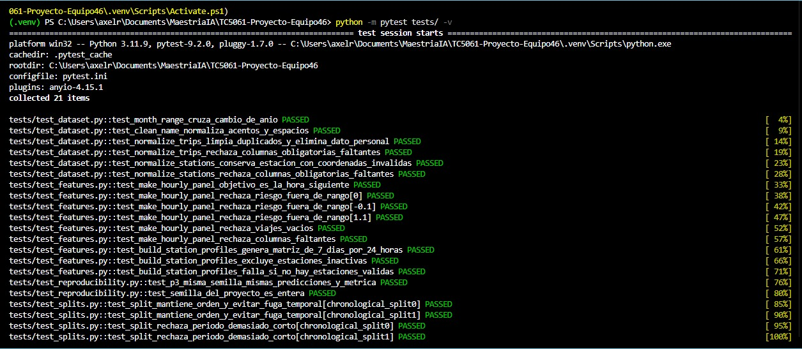

**Evidencia 2. Resumen de resultados de PyTest**

La siguiente evidencia presenta el resumen de la ejecución automatizada, confirmando que las 21 pruebas finalizaron satisfactoriamente.

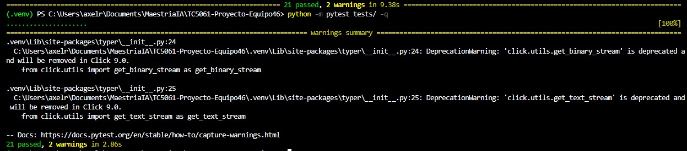

---

#### 1.9. Prueba de reproducibilidad del entrenamiento

**Responsable:** Axel Fernando Rábago Díaz.

##### 1.9.1. Objetivo

La reproducibilidad es un elemento fundamental de MLOps, ya que permite comprobar que un experimento puede repetirse bajo condiciones controladas y producir resultados consistentes.

Para esta actividad se incorporó una prueba relacionada con el algoritmo de clustering KMeans, utilizado en la pregunta P3 del proyecto MiBici, cuyo propósito es identificar grupos de estaciones que comparten patrones de uso similares.

##### 1.9.2. Procedimiento

Se realizaron dos entrenamientos controlados utilizando:

- El mismo conjunto de datos sintéticos.
- La misma configuración del algoritmo KMeans.
- La misma semilla aleatoria.
- Los mismos parámetros de entrenamiento.
- Las mismas condiciones de comparación.

Posteriormente, se compararon las predicciones obtenidas y la métrica correspondiente para identificar posibles diferencias entre ambas ejecuciones.

Adicionalmente, se verificó que la semilla configurada en el proyecto correspondiera a un valor entero.

Es importante considerar que establecer una semilla fija ayuda a controlar la aleatoriedad, pero la reproducibilidad también depende de otros elementos, como los datos utilizados, las versiones de las bibliotecas y las condiciones de ejecución.

##### 1.9.3. Ejecución de la prueba

Para ejecutar únicamente las pruebas de reproducibilidad:

```powershell
python -m pytest tests/test_reproducibility.py -v
```

##### 1.9.4. Resultados obtenidos

Se ejecutaron las siguientes pruebas:

| Prueba | Resultado |
|---|---|
| `test_p3_misma_semilla_mismas_predicciones_y_metrica` | PASSED |
| `test_semilla_del_proyecto_es_entera` | PASSED |

El resultado registrado fue:

```text
2 passed in 1.61s
```

Los resultados permiten comprobar la consistencia del entrenamiento controlado de KMeans bajo las condiciones establecidas.

Es importante señalar que esta validación utiliza datos sintéticos y no representa una reproducción completa del pipeline de entrenamiento de MiBici ni de los experimentos registrados en MLflow.

Por lo tanto, se considera una prueba automatizada de reproducibilidad de un componente del entrenamiento.

##### 1.9.5. Evidencia de reproducibilidad

**Evidencia 3. Ejecución de las pruebas de reproducibilidad de KMeans P3**

La siguiente captura muestra la ejecución individual de las dos pruebas de reproducibilidad, ambas con resultados satisfactorios.

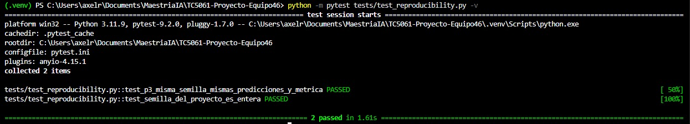

---

### 2. Validación de datos con DeepChecks

**Responsable:** Ivan Plata Garnica.

**Estado:** Implementado y ejecutado para los pipelines P1, P2 y P3.

#### 2.1. Objetivo

Incorporar validaciones reproducibles de integridad y calidad de datos en los conjuntos utilizados por los modelos. Los chequeos ayudan a detectar esquemas incompletos, valores faltantes o inválidos, duplicados, tipos inconsistentes, posibles anomalías y cambios de distribución entre particiones, cuando aplica.

#### 2.2. Implementación

La lógica se encuentra en `mibici/modeling/data_validation.py` y se invoca desde los módulos de entrenamiento:

- **P1 y P2:** `validate_panel_splits` valida los conjuntos de entrenamiento, validación y prueba con la suite `data_integrity`. Después compara entrenamiento con validación y entrenamiento con prueba mediante `train_test_validation`. Entre los chequeos de las suites están valores nulos, tipos mezclados, duplicados, muestras atípicas, cambios de distribución de características y del objetivo, y posibles fugas temporales entre particiones.
- **P3:** `validate_station_profiles` aplica `data_integrity` por separado a los perfiles y a los metadatos de estaciones. Antes de ejecutar DeepChecks, el código rechaza perfiles vacíos o con identificadores de estación duplicados, metadatos vacíos o sin `station_id`, e identificadores faltantes o duplicados. P3 no compara conjuntos train/test porque este pipeline agrupa perfiles y no usa esas particiones.

Para P1 y P2, la preparación del dataset también comprueba que cada partición no esté vacía, que incluya `station_id`, `target_time` y el objetivo correspondiente, que las claves estación-hora no tengan valores faltantes o fechas inválidas y que no haya filas duplicadas por estación y hora. Las variables categóricas conocidas se indican al construir el dataset de DeepChecks.

Las dependencias específicas se fijan en `requirements-deepchecks.txt`: DeepChecks 0.19.1, NumPy 1.26.4 y Setuptools menor que 81, además de los requisitos del proyecto.

Desde la raíz del repositorio y con el entorno `.venv311` de Python 3.11 preparado, instalar las dependencias de validación:

```powershell
.\.venv311\Scripts\python.exe -m pip install -r .\requirements-deepchecks.txt
```

Los datos procesados por la ingesta deben estar disponibles. Ejecutar cada pipeline por separado:

```powershell
.\.venv311\Scripts\python.exe -m mibici.modeling.train
.\.venv311\Scripts\python.exe -m mibici.modeling.train_p2
.\.venv311\Scripts\python.exe -m mibici.modeling.train_p3
```

Los reportes HTML se generan en `reports/deepchecks/`:

| Pipeline | Reportes generados |
|---|---|
| P1 | `p1_train_integrity.html`, `p1_validation_integrity.html`, `p1_test_integrity.html`, `p1_train_vs_validation.html`, `p1_train_vs_test.html` |
| P2 | `p2_train_integrity.html`, `p2_validation_integrity.html`, `p2_test_integrity.html`, `p2_train_vs_validation.html`, `p2_train_vs_test.html` |
| P3 | `p3_profiles_integrity.html`, `p3_metadata_integrity.html` |

En total, las ejecuciones documentadas generaron 12 reportes: cinco para P1, cinco para P2 y dos para P3. Por su tamaño, los HTML se generan localmente y `reports/deepchecks/` está excluido de Git; las capturas de ejecución que se conservan como evidencia están en `docs/evidencias_semana7/`.

#### 2.3. Resultados de validación

Los tres comandos terminaron correctamente y registraron sus ejecuciones en MLflow. Las suites de DeepChecks se ejecutaron y generaron los reportes indicados. Las métricas de la tabla siguiente pertenecen a los modelos; no son puntuaciones de DeepChecks.

| Pipeline | Resultado del entrenamiento registrado |
|---|---|
| P1 | MAE de prueba: 1.4756 |
| P2 | F1 de prueba: 0.0000 |
| P3 | K=3; Silhouette: 0.4506; Calinski-Harabasz: 263.9313 |

Que los pipelines hayan finalizado confirma que las suites se ejecutaron y generaron los informes; no significa que todas las condiciones hayan pasado. Al revisar los reportes generados el 4 de noviembre de 2026 se encontraron estos resultados:

- **Comprobaciones comunes:** en los informes de integridad de P1, P2 y P3, los tipos de datos mezclados pasaron y el chequeo de duplicados reportó 0%. Las comparaciones temporales de P1 y P2 no detectaron fuga de fechas ni de índices; el chequeo de *feature drift* pasó para las 12 variables evaluadas. El chequeo **Mixed Nulls** pasó, lo que indica que no encontró una mezcla de representaciones de nulos; no equivale a afirmar que todas las columnas estén libres de valores faltantes.
- **P1:** los informes de integridad señalaron como constantes **capacity** y **risk_threshold**, además de pares de variables con correlación mayor a 0.9. En la comparación train/validation, **Train Test Samples Mix** encontró 5.21% de muestras repetidas, por encima del umbral de 5%. En train/test, **Multivariate Drift** obtuvo 0.31, por encima del umbral de 0.25; el solapamiento de muestras fue 1.25%.
- **P2:** se señalaron correlaciones mayores a 0.9 entre algunas variables, y **target_time** presentó Predictive Power Score de 0.04 frente al umbral de 0. En validación y prueba se reportaron etiquetas conflictivas en proporciones de 0.008% y 0.002%, respectivamente. El solapamiento train/validation fue 8.32%, por encima del umbral de 5%; train/test fue 4.41%. **Multivariate Drift** fue 0.30 en train/test (umbral 0.25) y 0.24 en train/validation.
- **P3:** los informes señalaron columnas constantes: 18 de las 337 variables de perfiles, y **active** y **coords_valid** en los metadatos. También encontraron pares de variables de perfil con correlación superior a 0.9.

Estas condiciones señaladas requieren interpretación en el contexto del proyecto. Algunas pueden corresponder a variables redundantes o patrones esperados (por ejemplo, columnas de conteos con valor cero en ciertos horarios), pero el reporte por sí solo no determina si deben conservarse. Por ello, el resultado documentado es una ejecución exitosa con observaciones identificadas para revisión, no una certificación de que el dataset esté completamente libre de problemas.

Durante las ejecuciones también aparecieron advertencias de dependencias (incluida una advertencia deprecada de `DataFrame.applymap` en DeepChecks y, en P3, inferencia automática de variables categóricas y una advertencia numérica de correlación). No impidieron que los comandos terminaran ni que se guardaran los reportes.

#### 2.4. Evidencias

Las siguientes capturas muestran el comando de cada pipeline, la ejecución de las suites de DeepChecks y el mensaje final de registro exitoso.

**Evidencia 4. Ejecución de DeepChecks para P1**

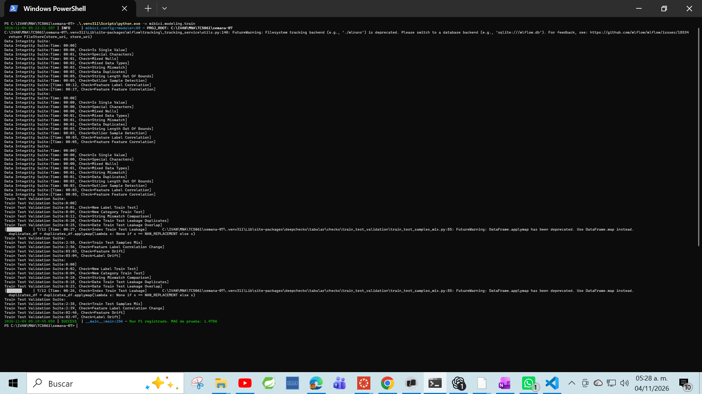

**Evidencia 5. Ejecución de DeepChecks para P2**

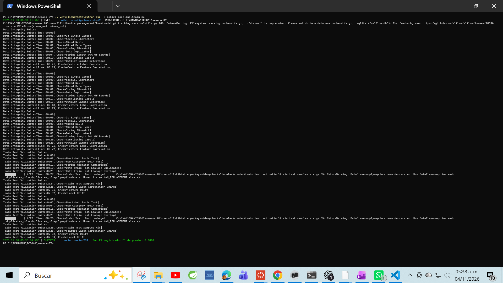

**Evidencia 6. Ejecución de DeepChecks para P3**

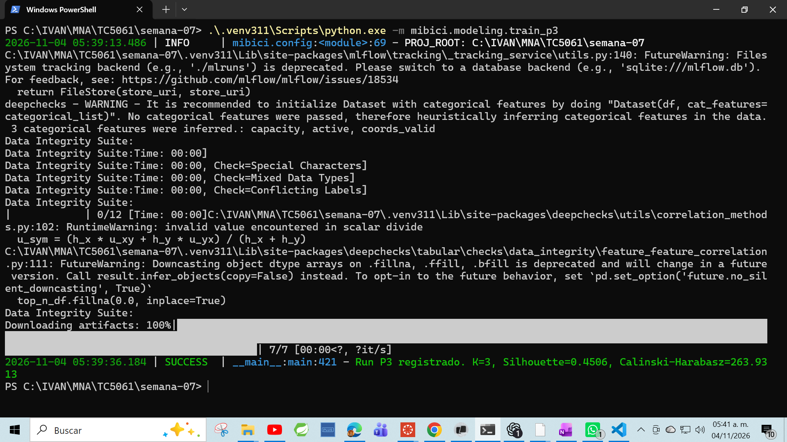

---

### 3. Revisión de seguridad del repositorio

**Responsable:** Mónica María Ramírez Mejía.

**Estado:** Revisión ejecutada y documentada. Se registran hallazgos de Bandit y pip-audit. El 4 de noviembre de 2026 se añadieron reglas para excluir el entorno `.venv311/` y los reportes HTML locales de DeepChecks.

#### 3.1. Objetivo

Revisar el manejo de credenciales y datos sensibles, las exclusiones del repositorio y las vulnerabilidades reportadas por herramientas de análisis estático y de dependencias.

#### 3.2. Credenciales, datos sensibles y reglas de exclusión

El archivo [.gitignore](.gitignore) excluye `.env`, los directorios `venv/`, `.venv/`, `.venv311/` y `env/`, los datos locales, los archivos de MLflow, los modelos serializados y los reportes HTML locales de DeepChecks. Se comprobó con:

    git check-ignore -v .env mlflow.db mlruns data/raw/ejemplo.csv models/modelo.pkl
    git check-ignore -v mlruns/ mlartifacts/
    git check-ignore -v .venv311/ reports/deepchecks/

| Elemento | Regla observada |
|---|---|
| .env | Excluido |
| data/raw/ | Excluido |
| mlruns/ y mlartifacts/ | Excluidos |
| mlflow.db | Excluido |
| Archivos .pkl | Excluidos |
| Entornos venv/, .venv/, .venv311/ y env/ | Excluidos |
| Reportes HTML locales de DeepChecks | Excluidos; las capturas de evidencia sí se conservan en `docs/evidencias_semana7/` |

La regla `.venv311/` evita que el entorno virtual local se agregue accidentalmente al repositorio. Los reportes HTML de DeepChecks también se regeneran localmente al ejecutar los pipelines; por su tamaño, no se versionan. Las capturas incluidas en `docs/evidencias_semana7/` documentan las ejecuciones.

Las referencias de configuración se cargan localmente con load_dotenv() en mibici/config.py. El archivo [.env.example](.env.example) contiene la plantilla sin credenciales; la variable de ejecución observada es MLFLOW_TRACKING_URI. Cada integrante crea su .env local, el cual está excluido por Git.

Las búsquedas indicadas no encontraron coincidencias de asignaciones con los patrones de credenciales en los tipos de archivo consultados; tampoco se encontró un .env versionado ni commits que lo hayan agregado:

    git grep -n -i -E '(password|passwd|secret|api[_-]?key|token)\s*[:=]' -- '*.py' '*.md' '*.yaml' '*.toml' '*.json'
    git ls-files -- .env
    git log --all --oneline -- .env

La búsqueda se limita a esos patrones y tipos de archivo; no constituye una garantía absoluta de ausencia de secretos.


#### 3.3. Análisis estático con Bandit

Se instalaron Bandit 1.9.4 y pip-audit 2.10.1:

    python -m pip install bandit==1.9.4 pip-audit==2.10.1
    python -m bandit --version
    python -m pip_audit --version

El análisis de 2,475 líneas de mibici/ registró **15 hallazgos de severidad baja**, sin hallazgos medios ni altos. Los 15 tienen confianza alta:

| Código | Descripción | Cantidad |
|---|---|---:|
| B404 | Importación del módulo subprocess | 5 |
| B603 | Llamadas a subprocess sin shell=True | 5 |
| B607 | Uso del nombre del ejecutable (git) sin ruta absoluta | 5 |

Los hallazgos están en experiment_p1.py, experiment_p2.py, train.py, train_p2.py y train_p3.py. Corresponden a llamadas con argumentos fijos para ejecutar git rev-parse HEAD y obtener el commit; no usan shell=True ni reciben argumentos del usuario. El equipo los clasifica como de bajo riesgo. El reporte completo está en [reports/security/bandit.txt](reports/security/bandit.txt).

    python -m bandit -r mibici
    python -m bandit -r mibici -f txt -o reports/security/bandit.txt


#### 3.4. Auditoría de dependencias con pip-audit

Se ejecutó la auditoría el 1 de noviembre de 2026:

    python -m pip_audit -r requirements.txt --no-deps --disable-pip -o reports/security/pip_audit.txt

El resumen de la herramienta reportó **53 vulnerabilidades conocidas en cuatro paquetes** de requirements.txt:

| Paquete | Versión fijada | Vulnerabilidades |
|---|---:|---:|
| pyarrow | 22.0.0 | 2 |
| requests | 2.32.5 | 2 |
| python-dotenv | 1.2.1 | 2 |
| mlflow | 3.6.0 | 47 |

El comando usa --no-deps, por lo que la auditoría cubre los paquetes declarados directamente en requirements.txt, no sus dependencias indirectas. El detalle y las versiones que corrigen los avisos están en [reports/security/pip_audit.txt](reports/security/pip_audit.txt).

Las dependencias vulnerables no se actualizaron como parte de esta revisión. En particular, actualizar MLflow puede afectar los experimentos y el registro de modelos; cualquier actualización debe validarse con una nueva ejecución del flujo correspondiente.


#### 3.5. Evidencias

Las capturas siguientes documentan la instalación de herramientas, las comprobaciones de credenciales y exclusiones, y las salidas de Bandit y pip-audit.

**Evidencia 1. Herramientas instaladas**

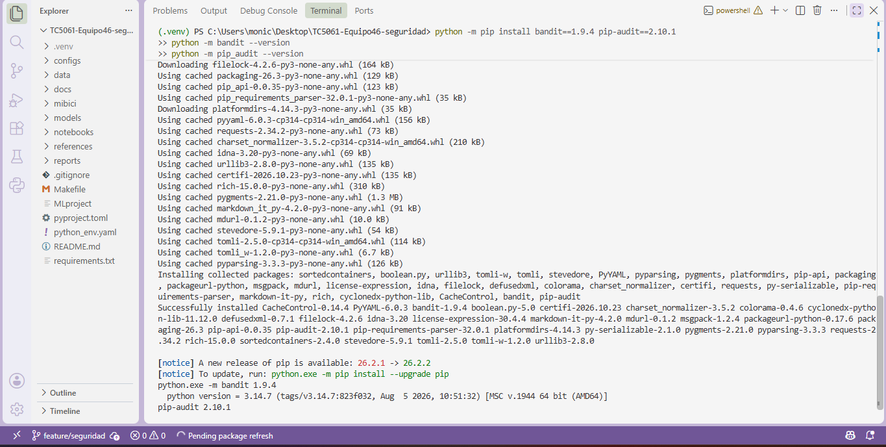

**Evidencia 2. Reglas de exclusión para archivos**

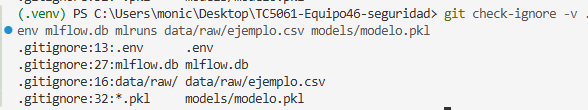

**Evidencia 3. Reglas de exclusión para carpetas**

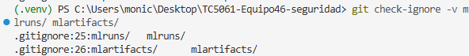

**Evidencia 4. Variable de entorno**

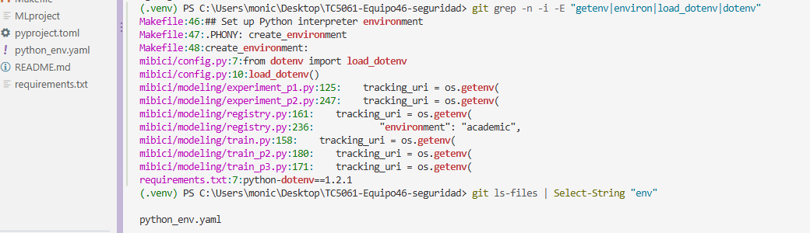

**Evidencia 5. Búsqueda de credenciales**

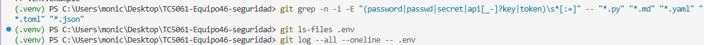

**Evidencia 6. Resumen de Bandit**

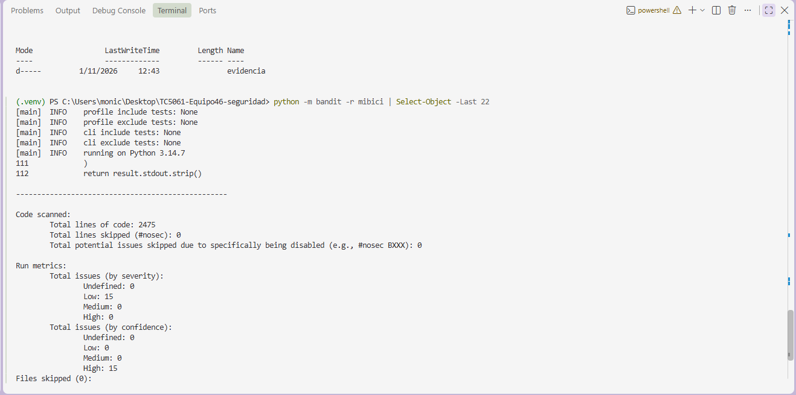

**Evidencia 7. Detalle de los hallazgos de Bandit**

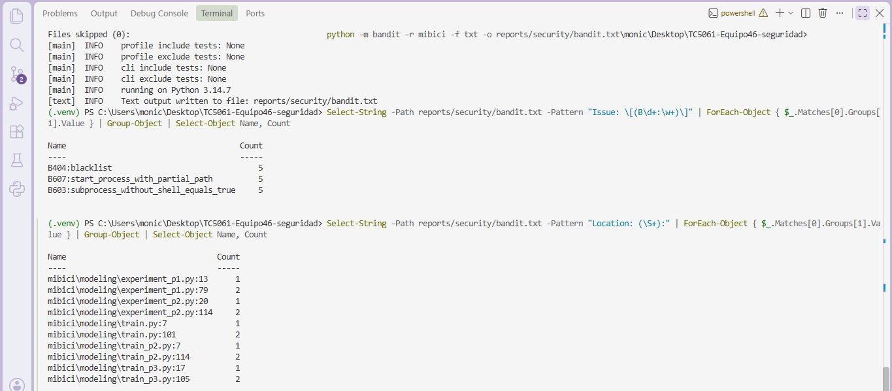

**Evidencia 8. Resultado de pip-audit**

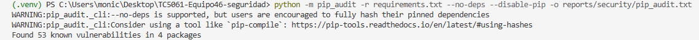

#### 3.6. Uso de IA

Se usó Claude (Anthropic, 2026) como apoyo para estructurar y redactar esta sección. Los comandos y las capturas corresponden a la ejecución reportada por Mónica.

---

### 4. Organización y ejecución de las verificaciones

#### 4.1. Estructura centralizada de pruebas

Con la finalidad de facilitar la ejecución y mantenimiento de las pruebas, se estableció una estructura centralizada dentro de la carpeta `tests/`.

La configuración de PyTest se encuentra en el archivo `pytest.ini`.

Esta organización permite incorporar nuevas pruebas conforme evolucione el proyecto, manteniendo un procedimiento de ejecución consistente.

#### 4.2. Comando general de ejecución

Para ejecutar las pruebas automatizadas ubicadas en la carpeta `tests/`:

```powershell
python -m pytest tests/ -v
```

La ejecución puede realizarse desde cualquier terminal que tenga acceso al proyecto y cuente con las dependencias necesarias.

#### 4.3. Ejecución individual de pruebas

También pueden ejecutarse las pruebas de forma independiente:

**Preparación de datos**

```powershell
python -m pytest tests/test_dataset.py -v
```

**Ingeniería de características**

```powershell
python -m pytest tests/test_features.py -v
```

**Reproducibilidad**

```powershell
python -m pytest tests/test_reproducibility.py -v
```

**Particiones temporales**

```powershell
python -m pytest tests/test_splits.py -v
```

Las verificaciones de seguridad mediante herramientas externas deberán documentarse adicionalmente, ya que no forman parte automáticamente de la ejecución de PyTest.

---

### 5. Trabajo colaborativo y control de versiones

El trabajo de la Semana 7 se desarrolla mediante ramas independientes, permitiendo que cada integrante incorpore sus aportaciones sin modificar directamente el trabajo de los demás.

Esta metodología facilita la revisión de cambios, la identificación de responsables y la integración de nuevas funcionalidades mediante Pull Requests.

#### 5.1. Contribución de Axel Fernando Rábago Díaz

**Rama de trabajo:**

`feature/semana7-pytest-axel`

**Commit local registrado:**

`35c39a8`

**Descripción del commit:**

```text
test: agrega 21 pruebas unitarias y reproducibilidad MiBici
```

Se incorporaron cinco archivos nuevos y 286 líneas de código, correspondientes a cuatro módulos de pruebas y la configuración de PyTest.

Los cambios fueron validados localmente mediante la ejecución satisfactoria de las 21 pruebas.

La contribución quedó integrada en `main` mediante el Pull Request #6.

#### 5.2. Contribuciones de Ivan Plata Garnica y Monica Maria Ramirez Mejia

**Ivan Plata Garnica — validación de datos con DeepChecks**

- Rama: feature/semana7-deepchecks-iniciales.
- Pull Request #9, integrado a main.
- La implementación valida P1, P2 y P3; los comandos, resultados y capturas se documentan en la sección 2.

**Monica Maria Ramirez Mejia — chequeos de seguridad**

- Pull Request #5, integrado a main.
- Ejecutó y documentó las revisiones de .gitignore, variables de entorno y búsqueda de credenciales.
- Ejecutó Bandit y pip-audit; los resultados, reportes y capturas se encuentran en la sección 3.
- La revisión detectó vulnerabilidades de dependencias, documentadas para su seguimiento. El 4 de noviembre de 2026 se añadió y verificó la regla de exclusión para `.venv311/`.

#### 5.3. Repositorio del proyecto

Repositorio central del Equipo 46:

https://github.com/iplatamx/TC5061-Proyecto-Equipo46

**Nombre del entregable:** `TC5061-Proyecto-Equipo46`.

La rama principal y versión consolidada del repositorio es `main`; las contribuciones de Semana 7 fueron integradas mediante los Pull Requests #5, #6, #9 y #10.

**Informe PDF de Semana 7:** [TC5061_Semana7_Equipo46.pdf](docs/TC5061_Semana7_Equipo46.pdf).

---

### 6. Conclusiones de la Semana 7

Las pruebas automatizadas implementadas permiten fortalecer la confiabilidad del proyecto MiBici, al comprobar el comportamiento de funciones importantes utilizadas durante la preparación y transformación de datos.

La ejecución satisfactoria de 21 pruebas demuestra que los escenarios evaluados producen los resultados esperados bajo las condiciones establecidas. Asimismo, la prueba de reproducibilidad de KMeans aporta evidencia sobre la consistencia de un entrenamiento controlado.

Uno de los aprendizajes más importantes de esta actividad es comprender que desarrollar un modelo de Machine Learning no termina cuando conseguimos buenas métricas de desempeño. También es necesario demostrar que los procesos utilizados para obtener esos resultados son verificables y pueden ejecutarse de manera consistente.

Consideramos que la incorporación de pruebas automatizadas representa un avance importante en la aplicación de MLOps, ya que permite identificar errores de manera anticipada y reducir el riesgo de introducir modificaciones que afecten componentes existentes.

Finalmente, la organización de las pruebas y su documentación facilita que los integrantes del equipo puedan ejecutar nuevamente las verificaciones, revisar los resultados y continuar incorporando controles de calidad conforme evolucione el proyecto.

Los resultados de DeepChecks y de los chequeos de seguridad se documentan en las secciones 2 y 3, junto con los comandos, hallazgos y evidencias disponibles.

---

### 7. Referencias

Bandit. (s. f.). *Bandit documentation*. https://bandit.readthedocs.io/en/latest/

DeepChecks. (s. f.). *DeepChecks documentation*. https://docs.deepchecks.com/

pip-audit. (s. f.). *pip-audit*. Python Package Index. https://pypi.org/project/pip-audit/

pytest development team. (s. f.). *pytest documentation*. https://docs.pytest.org/en/stable/

OWASP Foundation. (s. f.). *Machine learning security top ten*. https://owasp.org/www-project-machine-learning-security-top-10/

---

## Semana 8 — API de predicción MiBici en contenedor

Esta sección documenta los puntos 1–6 de la actividad integradora. El servicio expone el modelo P1 de demanda mediante FastAPI y lo ejecuta en una imagen OCI construida con Docker usando el archivo `Containerfile`.

### 1. Recuperar el modelo desde MLflow Model Registry

La API recupera el modelo registrado `mibici-equipo46-p1-demanda` con el alias `champion` (P1-HGB-02, `HistGradientBoostingRegressor`). La referencia del Registry es `models:/mibici-equipo46-p1-demanda@champion`. Al iniciar FastAPI, `MiBiciModelService` resuelve el alias a una versión concreta y carga el modelo una sola vez con MLflow; las solicitudes reutilizan el modelo en memoria. Para tomar una versión nueva asignada al alias, se reinicia el contenedor. La integración se detalla en [Semana8_API_FastAPI.md](docs/Semana8_API_FastAPI.md).

La base SQLite del Registry y sus artefactos locales no se versionan en Git. Se debe iniciar MLflow contra la misma base y almacenamiento que contienen el alias y los artefactos; una base nueva y vacía no encontrará el modelo. Si `champion` ya existe y los artefactos están disponibles, no hace falta reentrenar.

Si el alias no existe y los datos procesados están disponibles, reproduce las búsquedas P1, P2 y P3 y registra los modelos. El script `mibici.modeling.registry` selecciona y registra las tres preguntas, por lo que necesita candidatos válidos para las tres:

```powershell
$env:MLFLOW_TRACKING_URI = "http://127.0.0.1:5000"
python -m mibici.dataset --verify
mlflow run . -e search_p1 --env-manager local --experiment-name mibici-equipo46
mlflow run . -e search_p2 --env-manager local --experiment-name mibici-equipo46
mlflow run . -e search_p3 --env-manager local --experiment-name mibici-equipo46
python -m mibici.modeling.registry
```

Si los archivos procesados todavía no existen, ejecuta antes la ingesta indicada en [Experimentación avanzada y Model Registry](#experimentación-avanzada-y-model-registry--semana-6).

### 2. API REST con FastAPI

La aplicación se inicia con Uvicorn y ofrece estos endpoints:

| Método | Ruta | Uso |
|---|---|---|
| GET | `/health` | Estado del servicio; responde 200 si el modelo se cargó y 503 si no está disponible. |
| GET | `/model-info` | Nombre, versión, URI y variables del modelo cargado. |
| POST | `/predict` | Predicción para una estación. |
| POST | `/predict/batch` | Predicciones para entre 1 y 1000 estaciones. |
| GET | `/docs` | Documentación interactiva de Swagger UI. |

### 3. Esquemas y validación de entradas

`PredictionInput` valida las ocho variables del contrato de P1 antes de llamar al modelo. Rechaza campos desconocidos, tipos de texto o booleanos donde se esperan números, valores fuera de rango y un indicador de fin de semana que no coincida con el día.

| Campo | Tipo | Restricción |
|---|---|---|
| `station_id` | entero | mayor que 0 |
| `departures_this_hour` | entero | mayor o igual a 0 |
| `arrivals_this_hour` | entero | mayor o igual a 0 |
| `departures_mean_last_24h` | decimal | mayor o igual a 0; finito |
| `departures_mean_last_168h` | decimal | mayor o igual a 0; finito |
| `target_hour` | entero | de 0 a 23 |
| `target_dayofweek` | entero | de 0 a 6; lunes es 0 |
| `target_is_weekend` | entero | 0 o 1; debe ser 1 cuando el día sea sábado o domingo |

Las peticiones inválidas reciben HTTP 422. La respuesta de predicción incluye el identificador de estación, la demanda estimada no negativa, el nombre del modelo y su versión. El contrato de variables se documenta en [Semana8_Axel_ModelRegistry.md](docs/Semana8_Axel_ModelRegistry.md); los endpoints y esquemas Pydantic están detallados en [Semana8_API_FastAPI.md](docs/Semana8_API_FastAPI.md).

### Construir la imagen

Con Docker Desktop activo, desde la raíz del repositorio:

```powershell
docker build -t mibici-equipo46-api:semana8 -f Containerfile .
```

El Containerfile instala las dependencias fijadas en `requirements.txt`, incluye el runtime de OpenMP requerido por scikit-learn y arranca Uvicorn en el puerto 8000.

### Preparar MLflow para Docker

El contenedor usa `http://host.containers.internal:5000` como `MLFLOW_TRACKING_URI`. Inicia el servidor en el directorio de la base del Registry, contra la misma base y raíz de artefactos donde se registró el modelo. Sustituye las rutas de ejemplo por las de ese equipo:

```powershell
$registryDb = "sqlite:///C:/RUTA/AL/REGISTRY/mlflow.db"
$artifactRoot = "file:///C:/RUTA/AL/ARTEFACTOS/mlruns"
$allowedHosts = "localhost,localhost:5000,127.0.0.1,127.0.0.1:5000,host.containers.internal,host.containers.internal:5000"

mlflow server --backend-store-uri $registryDb --default-artifact-root $artifactRoot --no-serve-artifacts --host 127.0.0.1 --port 5000 --workers 1 --allowed-hosts $allowedHosts
```

En esta configuración académica, los artefactos están en un directorio local y el servidor se ejecuta sin proxy de artefactos (`--no-serve-artifacts`). Por eso, además de la URI del Registry, Docker necesita un bind mount del directorio `models` de MLflow en la misma ruta absoluta que registra el URI del artefacto. En Windows, una URI `file:///C:/...` corresponde dentro del contenedor Linux a una ruta `/C:/...`. El siguiente ejemplo usa la ruta de esta ejecución; ajústala a la ubicación real que devuelve MLflow en otro equipo:

```powershell
$modelsHost = "C:/IVAN/MNA/TC5061/semana-07/mlruns/2/models"
$modelsTarget = "/C:/IVAN/MNA/TC5061/semana-07/mlruns/2/models"
```

El montaje se deja con escritura porque MLflow crea el archivo `registered_model_meta` al resolver el modelo registrado.

### Levantar el contenedor

Docker Desktop no define siempre el alias `host.containers.internal` de Podman; se añade el mapeo al gateway del anfitrión al ejecutar:

```powershell
$runArgs = @(
  "run", "--detach", "--rm", "--name", "mibici-equipo46-api",
  "--publish", "8000:8000",
  "--add-host", "host.containers.internal:host-gateway",
  "--mount", "type=bind,source=$modelsHost,target=$modelsTarget",
  "mibici-equipo46-api:semana8"
)
docker @runArgs
```

Consulta los logs y detén el servicio con:

```powershell
docker logs mibici-equipo46-api
docker stop mibici-equipo46-api
```

Mantén disponible el servidor MLflow y el directorio de artefactos mientras el contenedor esté en uso. Esta configuración monta los artefactos del host; para mover la imagen a otra máquina hay que proporcionar allí su propio Registry y artefactos accesibles, o preparar otra estrategia de empaquetado.

### Consumir y comprobar la API

La aplicación queda disponible en `http://localhost:8000`. Primero comprueba que el modelo se cargó:

```powershell
Invoke-RestMethod http://localhost:8000/health
Invoke-RestMethod http://localhost:8000/model-info
```

Ejemplo de petición válida a `POST /predict`:

```powershell
$body = @{
  station_id = 1
  departures_this_hour = 5
  arrivals_this_hour = 4
  departures_mean_last_24h = 3.5
  departures_mean_last_168h = 4.2
  target_hour = 9
  target_dayofweek = 1
  target_is_weekend = 0
} | ConvertTo-Json

Invoke-RestMethod -Uri http://localhost:8000/predict -Method Post -Body $body -ContentType "application/json"
```

Respuesta observada con P1, versión 1:

```json
{
  "station_id": 1,
  "predicted_departures_next_hour": 3.9233,
  "model_name": "mibici-equipo46-p1-demanda",
  "model_version": "1"
}
```

Por ejemplo, cambiar `target_hour` a 24 produce HTTP 422. En esta ejecución, `/health` confirmó `model_loaded: true` y el endpoint `/predict` devolvió la predicción anterior desde el contenedor.

### Estrategia de despliegue

Se eligió inferencia en tiempo real: cada solicitud HTTP obtiene una predicción inmediata para una estación. FastAPI carga el modelo champion al arrancar y lo conserva en memoria, evitando una consulta al Registry por cada petición. `/predict/batch` permite procesar un grupo de hasta 1000 estaciones en una sola llamada, aunque el servicio no realiza trabajos por lotes fuera de línea. Es una implementación académica local, no un servicio de producción.
