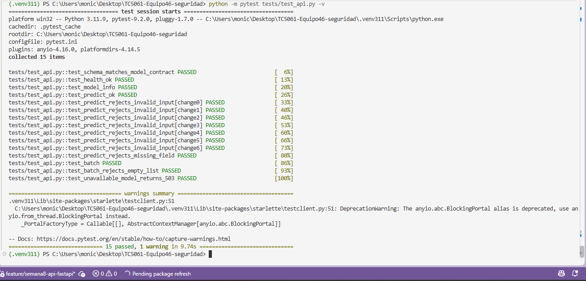
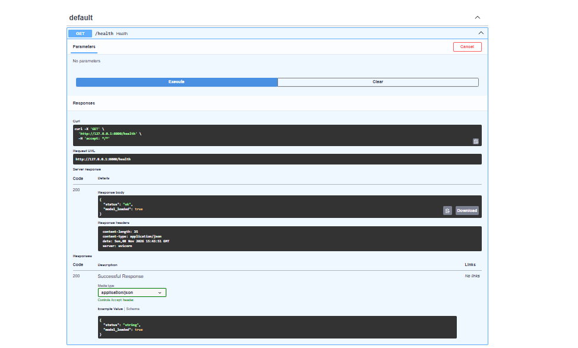
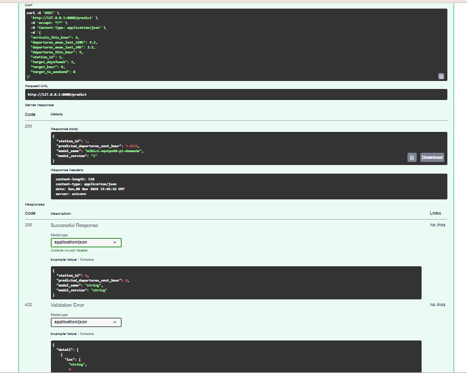
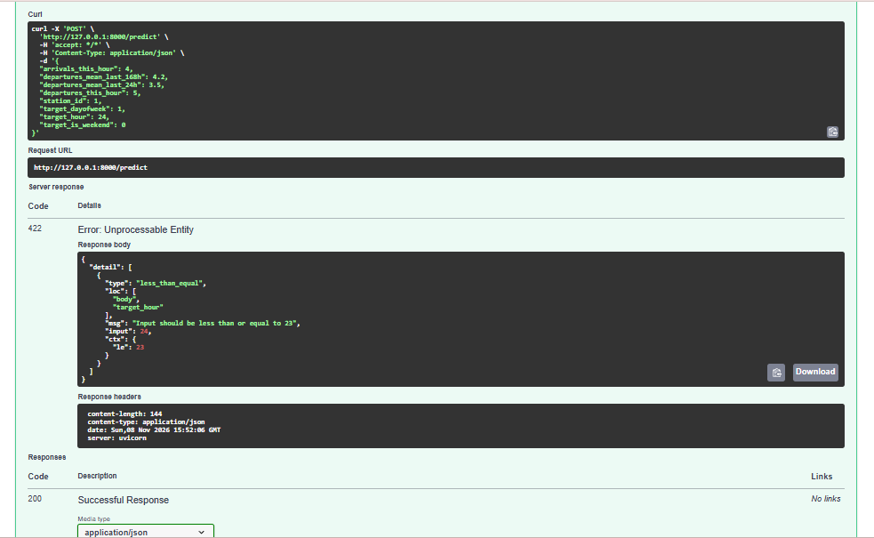

# Semana 8 — API REST con FastAPI y validación con Pydantic (Monica)

## Objetivo de mi contribución

Me corresponden los puntos 2 y 3 de la actividad: construir la API REST que expone el modelo P1 y definir los esquemas de entrada y salida con Pydantic. La API usa el servicio de Axel (`mibici.serving.model_loader.MiBiciModelService`), que recupera el modelo `mibici-equipo46-p1-demanda@champion` del Model Registry.

## Archivos

| Archivo | Contenido |
|---|---|
| `api/main.py` | Aplicación FastAPI y endpoints. |
| `api/schemas.py` | Esquemas Pydantic de entrada y salida. |
| `tests/test_api.py` | Pruebas de la API con un servicio simulado (no requiere MLflow). |
| `requirements.txt` | Se agregan `fastapi`, `uvicorn`, `pydantic` y `httpx` con versión fija. |

## Endpoints

| Método | Ruta | Descripción |
|---|---|---|
| GET | `/health` | Estado del servicio. `200` si el modelo está cargado; `503` si no se pudo cargar. |
| GET | `/model-info` | Nombre, versión, URI del modelo y lista de variables. |
| POST | `/predict` | Predicción para una estación. |
| POST | `/predict/batch` | Predicción para varias estaciones (1 a 1000) en una sola petición. |
| GET | `/docs` | Documentación interactiva (Swagger UI) generada por FastAPI. |

## Diseño

- **Carga única del modelo.** `MiBiciModelService()` se crea una sola vez en el evento `lifespan` de FastAPI, al arrancar. Las peticiones reutilizan el modelo en memoria; no se consulta MLflow en cada solicitud.
- **Arranque tolerante a fallos.** Si MLflow no responde al iniciar, la API arranca de todos modos: `/health` devuelve `503` con `model_loaded: false` y los endpoints de predicción responden `503`. El motivo queda en los logs. Así, en el contenedor, el problema se diagnostica con `/health` y `podman logs`.
- **Errores sin detalles sensibles.** Validación → `422` con el campo que falló; fallo interno → `500` con un mensaje genérico. El detalle completo solo va a los logs.

## Esquema de entrada (`PredictionInput`)

Los campos son exactamente las ocho variables del contrato de Axel (`FEATURE_COLUMNS`), en el mismo orden. Una prueba (`test_schema_matches_model_contract`) falla si alguno de los dos cambia sin el otro.

| Campo | Tipo | Regla Pydantic |
|---|---|---|
| `station_id` | int | `> 0` |
| `departures_this_hour` | int | `>= 0` |
| `arrivals_this_hour` | int | `>= 0` |
| `departures_mean_last_24h` | float | `>= 0`, sin `NaN`/`inf` |
| `departures_mean_last_168h` | float | `>= 0`, sin `NaN`/`inf` |
| `target_hour` | int | `0–23` |
| `target_dayofweek` | int | `0–6` (lunes = 0) |
| `target_is_weekend` | int | `0–1` y debe coincidir con `target_dayofweek >= 5` |

Además:

- `extra="forbid"` rechaza campos que el modelo no usa (por ejemplo, `temperatura`).
- `strict=True` rechaza texto (`"5"`) o booleanos (`true`) donde se espera un número, igual que el contrato de Axel. Un entero sí se acepta en un campo decimal.

## Esquema de salida (`PredictionOutput`)

```json
{
  "station_id": 1,
  "predicted_departures_next_hour": 3.9233,
  "model_name": "mibici-equipo46-p1-demanda",
  "model_version": "1"
}
```

`predicted_departures_next_hour` es siempre `>= 0`, igual que en la evaluación original de P1. Incluir la versión en cada respuesta permite saber qué modelo generó cada predicción.

## Cómo probar mi parte (Windows PowerShell)

Entorno: **Python 3.11**, como indica la sección 1.5 de la Semana 7 del README (DeepChecks requiere NumPy 1.26.4).

### 1. Pruebas automáticas (no requieren MLflow)

```powershell
py -3.11 -m venv .venv311
.venv311\Scripts\activate
pip install -r requirements.txt
pip install -e .
python -m pip install pytest
python -m pytest tests/test_api.py -v
```

Resultado: **15 pruebas aprobadas**.

### 2. Prueba con el modelo real

Terminal 1, servidor de MLflow (dejarla abierta):

```powershell
.venv311\Scripts\activate
mlflow server --backend-store-uri sqlite:///mlflow.db --host 127.0.0.1 --port 5000 --workers 1
```

Terminal 2, generar y registrar el modelo P1 desde un clon limpio:

```powershell
.venv311\Scripts\activate
$env:MLFLOW_TRACKING_URI = "http://127.0.0.1:5000"
mlflow run . -e ingest --env-manager local --experiment-name mibici-equipo46
mlflow run . -e search_p1 --env-manager local --experiment-name mibici-equipo46
python -m mibici.serving.register_p1
python -m mibici.serving.verify_model
```

Resultados obtenidos:

| Paso | Resultado |
|---|---|
| Ingesta | Versión de datos `129a4a57efc7`: 3,361,307 viajes, 9 de 9 meses, 470 estaciones |
| Búsqueda P1 | P1-HGB-01: MAE 0.7498 · **P1-HGB-02: MAE 0.7352** · P1-HGB-03: MAE 0.7362 |
| Registro | `mibici-equipo46-p1-demanda`, versión 1, alias `champion` (P1-HGB-02) |
| Verificación | Recuperación OK; predicción de prueba 3.9233 |

Levantar la API (misma terminal 2):

```powershell
uvicorn api.main:app --reload --port 8000
```

Abrir <http://127.0.0.1:8000/docs> y ejecutar:

1. `GET /health` → `200`, `{"status": "ok", "model_loaded": true}`.
2. `POST /predict` con el ejemplo precargado → `200`, predicción `3.9233` (igual a la de `verify_model`).
3. `POST /predict` con `"target_hour": 24` → `422`, `"Input should be less than or equal to 23"`.

Desde PowerShell, la petición equivalente:

```powershell
$body = @{
  station_id = 1; departures_this_hour = 5; arrivals_this_hour = 4
  departures_mean_last_24h = 3.5; departures_mean_last_168h = 4.2
  target_hour = 9; target_dayofweek = 1; target_is_weekend = 0
} | ConvertTo-Json
Invoke-RestMethod -Uri http://127.0.0.1:8000/predict -Method Post -Body $body -ContentType "application/json"
```

## Notas para el contenedor (integrante 3)

- Comando de arranque: `uvicorn api.main:app --host 0.0.0.0 --port 8000`.
- La imagen debe incluir `api/`, `mibici/` y `pyproject.toml`, e instalar el paquete (`pip install .`) para que `mibici.serving` se pueda importar.
- Variables que lee el servicio de Axel: `MLFLOW_TRACKING_URI` (en Podman, `http://host.containers.internal:5000`), `MIBICI_MODEL_NAME`, `MIBICI_MODEL_ALIAS` y `MIBICI_MODEL_VERSION` (opcional).
- MLflow 3.6 arranca con un filtro de seguridad que solo acepta conexiones locales (`Security middleware enabled with default settings (localhost-only)`). Para que el contenedor lo alcance, el servidor debe iniciarse con `--host 0.0.0.0` y `--allowed-hosts`, como indica ese mismo mensaje.
- Para comprobar el contenedor: primero `GET /health` (debe dar `200`) y después `POST /predict`; la predicción del ejemplo debe ser `3.9233`.

## Evidencias

**Evidencia 1. Pruebas de la API (15 aprobadas, Python 3.11.9)**



**Evidencia 2. `GET /health` con el modelo cargado desde el Model Registry**



**Evidencia 3. `POST /predict` con el modelo real (`mibici-equipo46-p1-demanda` v1)**



**Evidencia 4. `POST /predict` rechaza una entrada inválida (`target_hour = 24`)**


