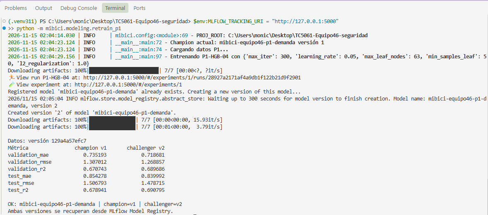
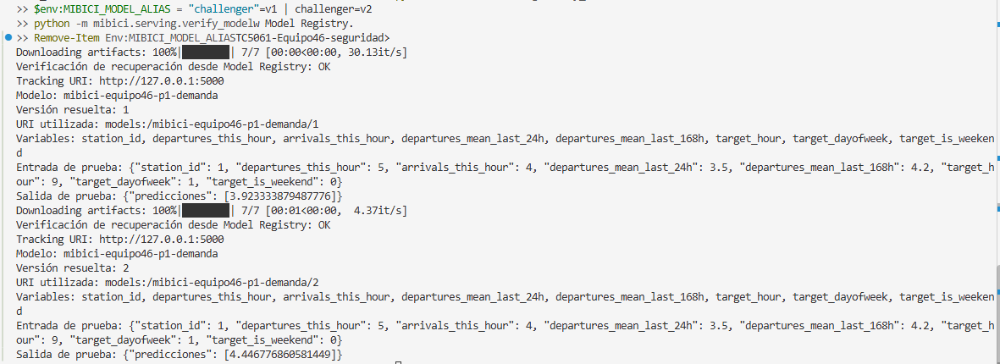
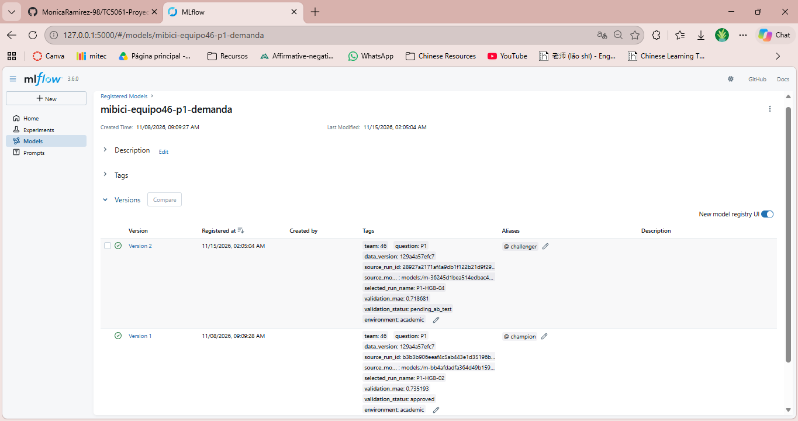
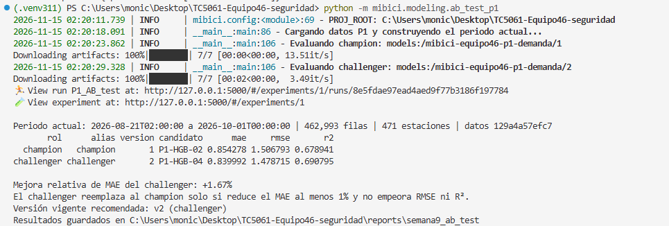
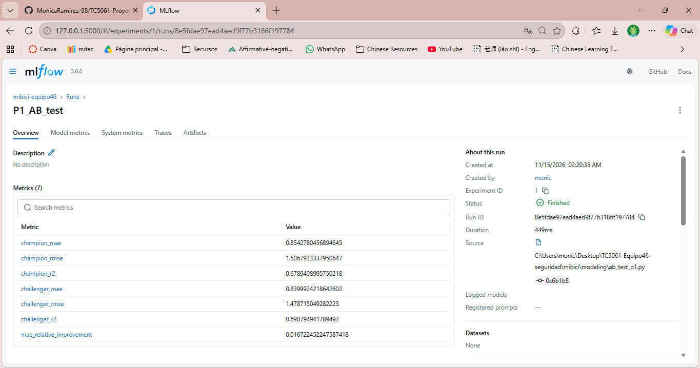
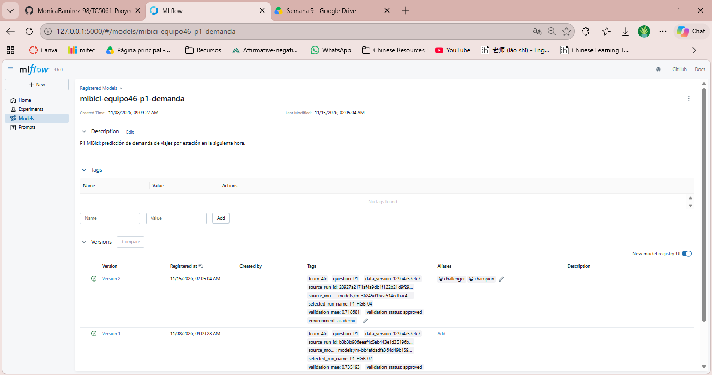
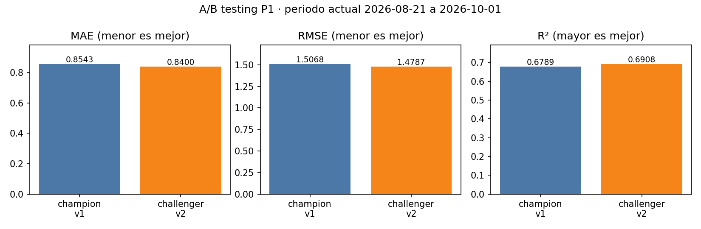

# Semana 9 - Reentrenamiento, A/B testing y Continuous Training (Mónica)

> **Nota.** Este análisis se realizó de forma independiente, antes de integrar el análisis de octubre de 2026 ([semana9_entrenamiento_abtest.md](semana9_entrenamiento_abtest.md)). Los números de versión corresponden al MLflow local de quien ejecutó este análisis: aquí, la "versión 2" es el candidato `P1-HGB-04`, y la decisión de la sección 2 aplica solo a ese registro local. La decisión final del equipo sobre la versión vigente se documenta en el reporte integrado.

## Objetivo

Esta sección documenta los puntos 4 y 5 de la actividad y la recomendación de Continuous Training del punto 6: el entrenamiento de una versión alternativa del modelo P1, su registro en MLflow Model Registry como nueva versión del mismo modelo, la comparación de ambas versiones sobre el periodo actual (A/B testing) y la decisión justificada sobre la versión vigente.

El periodo actual es el mismo que se utilizó en el reporte de *drift* con Evidently ([docs/Semana9_Axel_Secciones_1_a_3_Resultado_Real.md](Semana9_Axel_Secciones_1_a_3_Resultado_Real.md)).

## Archivos

| Archivo | Contenido |
|---|---|
| `mibici/modeling/retrain_p1.py` | Entrena la versión alternativa y la registra con el alias `challenger`. |
| `mibici/modeling/ab_test_p1.py` | Compara `champion` y `challenger` sobre el periodo actual y aplica la regla de decisión. |
| `reports/semana9_ab_test/ab_test_metricas.csv` | Tabla de métricas de ambas versiones. |
| `reports/semana9_ab_test/ab_test_resultado.json` | Periodo evaluado, métricas y decisión. |
| `reports/semana9_ab_test/ab_test_metricas.png` | Gráfica comparativa de MAE, RMSE y R². |
| `docs/evidencias_semana9/` | Capturas de la ejecución. |

## 1. Versión alternativa del modelo (punto 4)

Se entrenó una nueva versión de P1 con **hiperparámetros distintos** a los de los candidatos de la Semana 6. Para que la comparación sea válida, se conservaron los mismos datos (versión `129a4a57efc7`), las mismas ocho variables y la misma partición cronológica 70/15/15 por hora objetivo que el modelo vigente.

| Hiperparámetro | `champion` v1 (P1-HGB-02) | `challenger` v2 (P1-HGB-04) |
|---|---:|---:|
| `max_iter` | 100 | 300 |
| `learning_rate` | 0.08 | 0.05 |
| `max_leaf_nodes` | 31 | 63 |
| `min_samples_leaf` | 20 (valor predeterminado) | 50 |
| `l2_regularization` | 0.0 (valor predeterminado) | 1.0 |

La versión alternativa usa más iteraciones con una tasa de aprendizaje menor, árboles con más hojas y regularización para limitar el sobreajuste. Los hiperparámetros se definieron antes de evaluar la partición de prueba, que no se utilizó para elegirlos.

### Registro en MLflow Model Registry

El modelo se registró como **versión 2** de `mibici-equipo46-p1-demanda`, con el alias `challenger` y las etiquetas `data_version`, `source_run_id`, `selected_run_name`, `validation_mae` y `validation_status: pending_ab_test`. El alias `champion` permaneció en la versión 1 hasta concluir el A/B testing.

| Métrica | `champion` v1 | `challenger` v2 |
|---|---:|---:|
| MAE de validación | 0.735193 | 0.718681 |
| RMSE de validación | 1.307012 | 1.268857 |
| R² de validación | 0.670743 | 0.689686 |

### Verificación de ambas versiones

Ambas versiones se recuperaron desde el registro con `verify_model` y respondieron a la misma entrada de prueba:

| Versión | Alias | Predicción para la entrada de prueba |
|---|---|---:|
| 1 | `champion` | 3.923333879487776 |
| 2 | `challenger` | 4.446776860581449 |

## 2. A/B testing (punto 5)

### Conjunto de evaluación

Ambas versiones se evaluaron sobre el **mismo conjunto del periodo actual**: la partición de prueba, que corresponde al 15 % final de la división cronológica. Es el mismo periodo definido como conjunto actual en el reporte de Evidently.

| Elemento | Valor |
|---|---|
| Periodo | 2026-08-21 02:00 a 2026-10-01 00:00 |
| Registros evaluados | 462,993 (conjunto completo, sin muestreo) |
| Estaciones | 471 |
| Versión de datos | `129a4a57efc7` |

El reporte de Evidently se generó con la versión de datos `d038fe16493d`. Ambas versiones contienen los mismos viajes y difieren solo en el catálogo de estaciones; el periodo actual coincide en fechas, número de registros (462,993) y número de estaciones (471).

### Resultados

| Versión | Candidato | MAE | RMSE | R² |
|---|---|---:|---:|---:|
| `champion` v1 | P1-HGB-02 | 0.854278 | 1.506793 | 0.678941 |
| `challenger` v2 | P1-HGB-04 | **0.839992** | **1.478715** | **0.690795** |

El `challenger` reduce el MAE en **1.67 %** y el RMSE en 1.86 %, y aumenta el R² en 0.0119 puntos. Las tres métricas se registraron en MLflow en la corrida `P1_AB_test`.

### Regla de decisión

Antes de la comparación se fijó la siguiente regla: **el `challenger` reemplaza al `champion` solo si reduce el MAE al menos 1 % y no empeora el RMSE ni el R²**. El MAE es la métrica principal porque expresa el error en viajes por hora, la unidad que interesa para operar las estaciones; el RMSE controla que no aumenten los errores grandes.

### Decisión

El `challenger` cumple las tres condiciones, por lo que **la versión 2 queda como versión vigente**. El alias `champion` se movió a la versión 2 y su estado cambió a `validation_status: approved`. La versión 1 se conserva en el registro sin alias, lo que permite volver a ella moviendo el alias si fuera necesario.

Como la API de la Semana 8 carga el modelo mediante el alias `champion`, basta reiniciar el servicio para que utilice la versión 2, sin reconstruir la imagen del contenedor.

## 3. Recomendación de Continuous Training (punto 6)

### Evidencia

- **Drift en las variables de demanda.** El reporte de Evidently detectó *drift* en 4 de 7 variables: las cuatro variables de demanda (`departures_this_hour`, `arrivals_this_hour`, `departures_mean_last_24h` y `departures_mean_last_168h`), con puntajes Wasserstein entre 0.1456 y 0.2592 frente a un umbral de 0.10. Las variables de calendario no presentaron *drift*.
- **Mayor error en el periodo posterior.** El MAE del modelo vigente pasó de 0.735193 en validación a 0.854278 en el periodo actual, un aumento de 16.2 %, consistente con un cambio en la distribución de la demanda.
- **Mejora disponible.** La versión alternativa redujo el error en el mismo periodo.

### Recomendación

**Sí conviene reentrenar el modelo de forma periódica.** La versión 2 mejora al modelo anterior, pero se entrenó con el mismo periodo de enero a julio. Como el *drift* se concentra en las variables de demanda, el siguiente reentrenamiento debería incluir los datos más recientes (agosto en adelante) para que el modelo aprenda el comportamiento actual.

### Propuesta de flujo

1. **Ingesta mensual.** Al publicarse un nuevo mes de datos abiertos, ejecutar la ingesta (`mlflow run . -e ingest`), que genera una nueva versión de datos.
2. **Monitoreo.** Generar el reporte de *drift* con Evidently comparando el periodo de entrenamiento del modelo vigente contra el mes más reciente.
3. **Disparadores de reentrenamiento.** Reentrenar si se cumple alguna de estas condiciones:
   - *drift* en al menos dos de las cuatro variables de demanda (puntaje Wasserstein mayor que 0.10);
   - MAE del modelo vigente en el mes más reciente al menos 10 % mayor que su MAE de validación;
   - en cualquier caso, una vez por trimestre.
4. **Reentrenamiento.** Entrenar candidatos con la ventana de datos actualizada y registrar el mejor como nueva versión con el alias `challenger` (`retrain_p1.py`).
5. **A/B testing.** Comparar `champion` y `challenger` sobre el periodo más reciente no utilizado en el entrenamiento, con la regla de decisión de la sección 2 (`ab_test_p1.py`).
6. **Promoción y reversión.** Si el `challenger` cumple la regla, mover el alias `champion` y reiniciar la API; la versión anterior permanece en el registro para revertir el cambio moviendo el alias.

### Limitaciones

- La comparación es retrospectiva, sobre datos históricos, y no sobre tráfico real de la API.
- La versión alternativa cambia los hiperparámetros, pero no la ventana de entrenamiento; el reentrenamiento con datos recientes queda como siguiente paso.
- La diferencia entre versiones es moderada (1.67 % en MAE); el umbral de 1 % evita promover cambios menores que podrían deberse a variación aleatoria.

## Cómo reproducir (Windows PowerShell)

Con Python 3.11, las dependencias de `requirements.txt` instaladas, el servidor de MLflow activo y el modelo `champion` registrado (ver Semana 8):

```powershell
$env:MLFLOW_TRACKING_URI = "http://127.0.0.1:5000"
python -m mibici.dataset
python -m mibici.modeling.retrain_p1
python -m mibici.serving.verify_model
$env:MIBICI_MODEL_ALIAS = "challenger"
python -m mibici.serving.verify_model
Remove-Item Env:MIBICI_MODEL_ALIAS
python -m mibici.modeling.ab_test_p1
python -m mibici.modeling.ab_test_p1 --promote
```

`ab_test_p1` sin `--promote` solo compara y recomienda; con `--promote`, mueve el alias `champion` si el `challenger` cumple la regla de decisión.

## Evidencias

**Evidencia 1. Entrenamiento y registro de la versión alternativa**



**Evidencia 2. Recuperación de ambas versiones desde el registro**



**Evidencia 3. Versiones y alias en MLflow Model Registry antes del A/B testing**



**Evidencia 4. Resultado del A/B testing**



**Evidencia 5. Corrida del A/B testing en MLflow**



**Evidencia 6. Promoción de la versión 2 a champion**



**Gráfica comparativa generada por el A/B testing**


